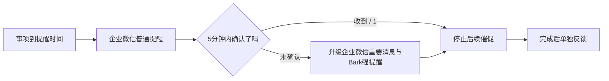

# 内务大总管 · Internal Steward

**把随口交代的一件事，接到提醒、确认和每日复盘里。**

一个以企业微信为入口的个人 AI 日程助手：自然语言记安排，程序校验日期与空档；普通提醒没确认，再升级 Bark 强提醒。每天早上看今日安排，晚上核对完成情况和明日计划。

[](https://github.com/yeahtom543-svg/internal-steward/actions/workflows/checks.yml)

[为什么做它](#为什么做它) · [实际能做什么](#实际能做什么) · [快速开始](#快速开始) · [部署与配置](#部署与配置) · [边界与限制](#边界与限制)

## 为什么做它

“记下来了”只是第一步。日常真正容易出问题的是：模型把明天算错、提醒发了却没看到、晚上说不清到底完成了什么。

内务大总管围绕这些小事建立一条可以核对的流程：**安排 → 提醒 → 确认收到 → 标记完成 → 复盘与次日确认**。

适合习惯在企业微信交代事情、希望自己管理模型和云服务配置的个人用户，也适合研究“聊天入口 + 可靠工具执行”的开发者。需要自行部署和配置，不提供免配置的公共机器人。

## 它的优势在哪里

| 设计 | 带来的实际价值 |
|---|---|
| **模型理解，程序校验** | 相对日期、星期和可用时间段由规则配合真实日程处理，减少模型直接猜日期或空档 |
| **提醒有后续** | 企业微信普通提醒未确认5分钟后升级 Bark 强提醒；发送失败按通道有限重试 |
| **确认足够轻** | 回复 `1` 或 `收到` 即可确认最近一项，多个事项可回复 `全部收到` |
| **已阅与完成分开** | 确认消息不会冒充任务完成；到点或过期也不会自动算作已完成 |
| **每天有开始和收尾** | 08:00晨报看今天；20:30晚报核对完成情况、重要倒数日和明日安排 |
| **把模型用在需要理解的地方** | 常见查询、确认、完成、重试和模板报表由程序执行，不为每次提醒额外调用模型 |
| **配置和源码分离** | 运行凭证通过环境变量注入，仓库带提交前检查和持续集成检查，便于安全自部署 |

没有宣称固定月费或“永远不会漏提醒”：实际费用和触达效果取决于模型用量、云服务、网络及手机通知设置。

## 实际能做什么

### 1. 用自然语言交代安排

以下是可尝试的输入示例，不是伪造的聊天截图：

```text
明天下午三点提醒我开会
帮我明天下午找一小时写报告
明天有什么事？
把明天第一项改到后天下午两点
```

- 支持新增、查询、改期、取消和空档排程。
- 时刻、任务时长或目标不明确时会追问；冲突时不会静默覆盖。
- 自动排程默认在09:00–18:00内寻找空档，并保留5分钟缓冲。
- 按日期分组，每天独立编号。
- 按北京时间理解日期；凌晨04:00之前的口语“明天”按即将到来的白天处理，明确日期和“自然日”声明优先。回复中的具体日期可供核对。

### 2. 普通提醒 → 未确认升级 → 停止催促



企业微信失败或未配置时可使用 WxPusher 备用通道；发送成功的通道不会因为另一通道失败而重复补发。同一轮每通道最多尝试3次。原本指定为强提醒的事项有独立的有限补催策略，不无限响铃。

`收到` 确认最近一项；`全部收到` 确认当前全部待确认提醒。需要指定某一项时，仍支持通知中的提醒码。主动推迟优先于自动催促。

### 3. 倒数日、晨报和晚报

```text
倒数日 考试 2027-06-07
倒数日
删除倒数日 考试
晨报
晚报
完成2
确认明天
```

- 重要长期事项按自然日倒数，出现在晨晚报中，不占用日程时段。
- **08:00晨报**：当天事项和重要倒数日。
- **20:30晚报**：已完成、待确认完成、待进行的事项，以及明日安排。
- `完成2` 按晨晚报中的当天完整列表标记完成，也可回复 `完成 完整标题`。
- `确认明天` 确认当前明日安排；增删或改期后需重新确认，不把旧确认套用到新计划。

### 4. 不止记事，也保留执行边界

模型工具请求经过校验再修改状态；读取或保存失败不会回复“已保存”。短期对话上下文帮助处理补充信息，消息ID缓存减少回调重试造成的重复执行。日记记录与未来日程分开处理。

## 快速开始

先验证源码与离线测试，再配置生产服务：

```sh
git clone https://github.com/yeahtom543-svg/internal-steward.git
cd internal-steward
npm ci --ignore-scripts
npm run check:secrets
npm test
git config core.hooksPath .githooks
```

离线测试使用合成数据，不读取实际日程、不发送通知。另有 `npm run test:model` 用于模型效果验证，运行时需要自己的模型凭证，会产生 API 费用；它不属于默认 CI 测试。

## 部署与配置

当前实现基于 **Node.js + 腾讯云 SCF/COS + 企业微信自建应用**，可接 DeepSeek 或自定义兼容接口；Bark 用于手机强提醒，WxPusher 为备用通道。

1. 准备企业微信自建应用及一个接收消息的成员账号，配置应用可见范围。
2. 在腾讯云部署 `index.js`、`package.json` 和生产依赖，入口为 `index.main_handler`。现有部署使用 Node.js 18.15；更换运行环境应重新验证 SDK 和回调。
3. 参照 [`.env.example`](.env.example) 在云函数环境变量中填写企业微信、模型和 COS 配置。该文件仅列空白变量，不会自动加载为运行配置。
4. 配置企业微信加密回调和服务器出口可信IP。不要把函数URL、电脑IP或全部网段当作可信IP。
5. 启用指向实际部署版本的分钟定时器：`0 * * * * * *`。代码按北京时间触发晨晚报并去重，不需要为每一件事创建一个定时器。
6. 依次验收消息回调、普通提醒、确认停止、强提醒升级和报表送达。

Bark、WxPusher、自定义模型的变量也在模板中。没有配置的通道会跳过。不要把实际 `.env`、Secret 或 API Key 复制到 issue、截图或提交记录中。

## 验证状态

- 源码包含业务回归和凭证保护测试；最新运行结果以本仓库 [Actions](https://github.com/yeahtom543-svg/internal-steward/actions) 为准。
- 已在实际部署中验证企业微信普通提醒送达，以及回调确认、倒数日保存/删除和报表查询。
- 5分钟升级、日期边界、晨晚报调度去重等逻辑有离线回归覆盖；手机响铃与每天到点送达仍需要各自部署后验收。

## 边界与限制

- Bark 强提醒**不是运营商电话外呼**，能否响铃取决于设备权限、系统和网络。
- 当前使用单文件 COS 状态，尚无完整并发写入冲突保护；也不承诺跨进程故障下严格“只发送一次”。
- 定时扫描有分钟级延迟。晨晚报失败有限重试，错过超过2小时的报表不补发。
- “平台受理”“手机送达”“本人确认”“任务完成”是不同状态，不互相替代。
- 当前主要面向个人使用，尚未提供完整的多租户权限隔离和管理界面。
- 仓库未附授权使用的许可证文件；公开可见不代表已授予任意商业使用权限。

## 安全与隐私

公开的是源码和合成测试数据，**不包含实际 AgentId、CorpId、成员账号、确认回执、API Key、Secret、真实日程、截图或历史验收文件**。凭证检查工具提供防误传保护，不能保证识别所有秘密；具体做法见 [SECURITY.md](SECURITY.md)。

如凭证已经泄露，需要在对应平台撤销或轮换；仅从仓库删除并不能让旧凭证失效。

## 一起把它做得更可靠

如果这个“聊天交代 → 分级提醒 → 确认 → 每日复盘”的思路对你有用，欢迎点一个 **Star**，方便后续找到项目，也让更多有同样需求的人看到它。

欢迎在 [Issues](https://github.com/yeahtom543-svg/internal-steward/issues) 分享：遇到的日期歧义、提醒体验、复现步骤和改进建议。请只提供去掉个人信息的合成示例，不要贴日程原文、聊天截图或任何凭证。
